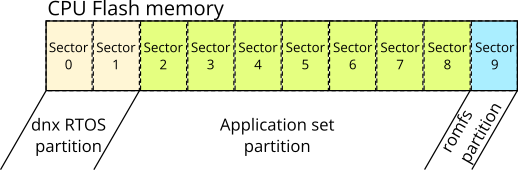

# dnx RTOS workspace
The dnx RTOS workspace is a set of operating system (dnx RTOS), application sets (appset),
common libraries, configuration and tools. The purpose of this repository is an example of basic
system configuration and as a reference project. Repository constructed in that way
allows user to create many different projects in single repository. It is much easier
to keep system up-to-date and also is much easier to create multi-processor projects,
because libraries can be shared between particular sub projects.

# Memory layout
There is many possibilities of memory layout configuration. The simplest is when
whole flash is used for operating system and application set (with or without
romfs file system). More complicated is when one want to use additionally custom
boot loader or boot loader based on dnx RTOS application set (that kind of boot loader
looks similarly to application).

Microcontrollers' flash memory is divided to several sectors mostly of the same size
(in some microcontrollers it is not a case). Groups of sectors (or at least single
sector) can be treated as partitions. Each partition has different purpose, e.g.
there can be partition for operating system, application set or read-only data.
Using dnx RTOS workspace there is possibility to install only selected partition
instead of install whole flash by programmer or boot loader. Also selected partition
can be compiled separately if dependencies are met.

In general there is possibility to configure partitions at any flash address, but
the problem could occur when user want to program partitions separately - flash
memory can be erased only by sectors. If partition borders are in the middle of
sector then single sector erase affects both partitions and application or
operating system could be erased and broken.

## Basic flash layout
In this layout there are three partitions:

- operating system
- application set
- romfs

There is possibility to reduce number of partitions to two but it is nice to have
romfs, because that file system is connection between build environment and
runtime environment, in general it is easy way to share files between PC and
microcontroller. That file system can be used to store configuration or display data
in easy way; it means that application can open file and use it as regular file.
There is not need to create special flash tables to store files.

## Flash layout with boot loader and application
In this layout there are boot loader section and application section (set of partitions).
The boot loader section contains operating system and application set partitions.
The application section contains operating system, application set and romfs
partitions.
